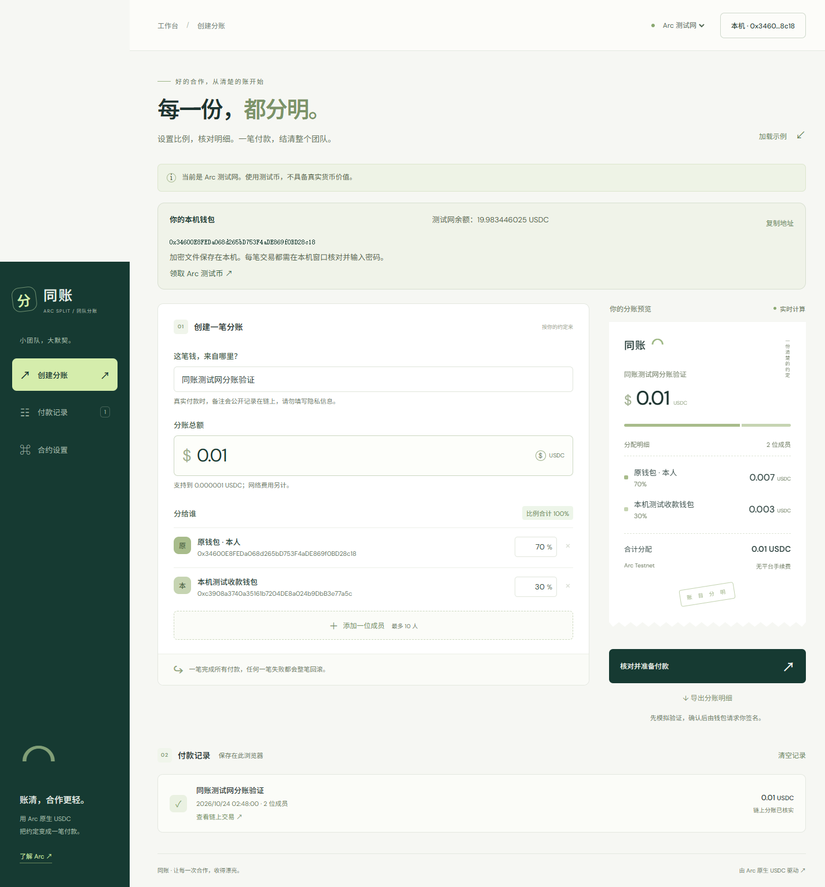

# 同账 / Arc Split

Native USDC payment splitting for small teams, with exact integer allocation, transaction simulation and verified onchain receipts. / 面向小团队的原生 USDC 分账工具，支持整数精度分配、发送前模拟和链上收据核验。

**Verified on Arc Testnet. Mainnet deployment is pending. / 已在 Arc 测试网实测，主网部署待完成。**

为小团队准备的 Arc 原生 USDC 分账应用。输入总额与成员比例，核对完整收款地址，一笔交易结清 2–10 位成员。

## Verified demo / 已核实演示

- [Source repository / 公开源码](https://github.com/zdfgu113/arc-split)
- [Arc Studio project / Studio 项目](https://studio.arc.io/app/7c4e4eec-0e7f-433b-ab84-b92b18606d70)
- [Testnet contract / 测试网合约](https://explorer.testnet.arc.io/address/0x949C9d12d52636FbDa31EaD80457a7AB7c5b8622)
- [Verified 0.01 USDC split / 已核实的 0.01 USDC 测试网分账](https://explorer.testnet.arc.io/tx/0xa4d5c52f36a6186a0a45f87cd433da395bde1a1e4b4c620dd5a4c7da14951ae7)

The payment returned 0.007 test USDC to the payer and sent 0.003 test USDC to a separately controlled recipient wallet. Both payouts, the contract event and exact balance changes were independently checked. / 本次付款向付款钱包返还 0.007 测试 USDC，并向另一个本人控制的收款钱包发送 0.003 测试 USDC；两笔金额、合约事件和精确余额变化均已独立核验。

25 Node tests passed. A 27-file application and verification-source snapshot was downloaded from Arc Studio and matched the tested local version byte for byte. Publication documentation, demo assets and the standalone HTTP-test fixture were added afterward; core application and signing logic are unchanged. / 25 项 Node 测试通过，从 Arc Studio 下载的一个包含 27 个应用及验证源码文件的快照与当时的本地测试版本逐字节一致；公开说明、演示素材及独立 HTTP 测试夹具随后补充，应用及签名核心逻辑保持一致。



## 已实现

- 网页托管版默认演示模式；本机钱包版默认测试网，仅自动读取公开地址，不解锁或签名。
- 整数金额计算、最大余数分配、精度与比例校验、明细 CSV 导出。
- 浏览器钱包连接、Arc 网络切换、合约部署代码核验、余额与费用检查、发送前模拟。
- 任一收款失败则整笔回滚；每个付款账户的同一付款编号不能重复支付。
- 只有交易成功且合约事件中的付款人、编号、金额、收款地址和备注匹配，才标记已付款。
- 超时保留待核状态，通过只读查询检查；不自动发起替代付款。
- 手机界面、键盘操作、减少动态效果、浏览器本地记录。
- 支持浏览器钱包与本机加密钱包。测试网部署和付款都需本人确认；不自动部署主网。

## 启动与验证

使用 Node.js 22.12 或更新版本。本次在 Windows、Node.js 26.3.0 上验证。

```powershell
npm ci
npm test
npm run build
npm run dev
```

`npm test` 包含金额边界检查、真实本地 EVM 转账、失败回滚、重复付款阻止与收据核验。本地 EVM 不是 Arc 节点，测试不等于已完成 Arc 链上交易，也不构成安全审计。

浏览器操作检查使用已安装的 Playwright CLI。托管版行为检查使用独立的静态预览端口，避免与本机签名服务混用：

```powershell
npm run preview -- --port 5179 --strictPort
npx --yes --package @playwright/cli playwright-cli -s=arc-static open http://127.0.0.1:5179/
npx --yes --package @playwright/cli playwright-cli -s=arc-static run-code --filename test/browser-smoke.js
```

浏览器检查只使用模拟钱包的取消响应，不向测试网或主网发送交易。

## 真实测试网操作

1. 在应用顶部选择 Arc 测试网，点击连接钱包，由钱包本人完成连接及网络确认。
2. 通过 [Circle 测试币页面](https://faucet.circle.com/) 为该地址领取测试网 USDC，不需要购买真实资金。
3. 打开合约设置，点击“用钱包部署测试网合约”，亲自核对钱包显示的网络与费用后确认。
4. 为每位成员填写实际控制的测试网收款地址与比例，先用小额验证。
5. 核对预览和完整地址，确认后在钱包中签名。应用取得成功收据并验证事件后才显示完成。

主网使用需另行核验收款与参赛资格、准备资金、由用户部署合约及完成真实小额交易。本轮没有执行这些操作。没有主网交易哈希时，不得把演示记录用于参赛付款证据。

## 本机加密钱包

不想安装浏览器钱包时，可以先创建一个由本人保管的独立 EVM 钱包。双击项目目录中的 `Create-Local-Wallet.cmd`，在本机窗口设置至少 12 位密码。密码通过进程标准输入传递，不写入命令参数、日志、代码或网站。

加密钱包默认保存到用户目录下的 `.codex\secrets\arc-split\wallet-v3.json`。创建窗口会将该目录访问权限限制为当前 Windows 用户与系统账户。文件采用标准 Web3 Secret Storage v3 格式，使用 ethers 的 scrypt 与 AES-128-CTR 加密实现，没有自行设计加密格式。创建后会从磁盘重新解锁，验证得到的地址与生成地址一致。

- 只向界面和公开状态文件输出地址与验证结果，私钥不会输出。
- 如果该位置已有钱包，窗口只允许验证解锁，不会覆盖或替换。
- `wallet-public.json` 只包含公开地址、文件位置与验证状态，不包含私钥或密码。
- 请离线备份 `wallet-v3.json`，密码另存；只备份地址无法恢复钱包。备份文件尚未由工具自动复制到外部介质。
- 创建窗口只负责创建或校验；下面的本机应用提供每笔交易的独立确认，不提供常驻解锁、自动签名或私钥导出。

验证已有钱包可以再次打开同一窗口，或使用：

```powershell
pwsh -NoProfile -STA -File scripts/Create-LocalWallet.ps1 -VerifyOnly
```

只查看公开地址，不解锁、不访问链上余额：

```powershell
node scripts/local-wallet.mjs address
```

钱包测试仅使用临时生成、未充值的测试密钥，测试结束即删除临时文件；不会读取真实钱包私钥。

### 用本机钱包运行同账

已有钱包并完成备份后，双击 `Open-Local-App.cmd`，或运行 `npm run local`。启动器构建应用并打开 [本机同账](http://127.0.0.1:5178/)，保持服务进程运行。该地址只能在当前电脑访问。已发布的私有网页仍使用浏览器钱包，本机签名服务不通过公网开放。

1. 本机版自动选择测试网并显示完整公开地址与余额；连接不解锁钱包。使用“复制地址”和 [Circle 测试币页面](https://faucet.circle.com/) 领取测试币，人机验证由本人完成。
2. 在合约设置中选择部署测试网合约。本机确认窗口显示网络编号、付款账户、费用上限与总支出上限；本人核对、勾选并输入创建钱包时的密码。
3. 填入自己控制的收款地址后预览分账。每次付款都会打开新的本机确认窗口，逐项显示全部完整地址与金额；密码不进入网页，也不交给常驻 HTTP 服务。

本机服务仅绑定 `127.0.0.1:5178`，校验 Host、精确 Origin、会话 Cookie、JSON 类型与专用请求头，不开放 CORS 或通用签名接口。签名子进程独立核查 Arc 网络、合约字节码、分账参数、余额、模拟结果、交易序号与有效期。只允许当前合约的分账功能和测试网当前版本合约的部署。

交易哈希在广播前写入钱包目录的 `signed-*.public.json`，相同付款编号可恢复原哈希。`nonce-*.public.json` 防止另一笔意图替换尚未核实的签名。**不要删除这些记录来尝试重复付款。** 如果广播结果不明，应用保留待核状态；当前版本不保存原始签名交易用于重播，需要人工核查后处理。交易记录不是钱包恢复材料，仍须保留加密钱包与密码。

本机行为检查可在服务运行、测试网余额为零时执行 `test/browser-local-wallet.js`。它只读取公开地址和余额，验证余额不足时拒绝部署，不输入真实钱包密码或发送交易。自动签名测试仅在本地模拟链中使用临时钱包。

## Arc 精度与网络

| 网络 | 链编号 | 原生币精度 | RPC |
| --- | --- | --- | --- |
| Arc 主网 | 5042 | 18 | https://rpc.mainnet.arc.io |
| Arc 测试网 | 5042002 | 18 | https://rpc.testnet.arc.io |

本应用以最多 6 位小数接受用户金额，按百万分之一 USDC 做整数分配，再乘以 10 的 12 次方得到原生交易单位。原生 USDC 与 ERC-20 USDC 是同一余额的不同接口，不要把 6 位小数直接用于原生 `msg.value`。发送费用上限至少为 20 Gwei，另从余额预留费用。

官方依据为 [网络配置](https://docs.arc.io/arc/references/connect-to-arc)、[原生稳定币模型](https://docs.arc.io/arc/concepts/stablecoin-native-model) 与 [EVM 差异](https://docs.arc.io/arc/references/evm-differences)。

## 构建来源与参赛状态

真实 Studio 工作区为 [同账 / Arc Split](https://studio.arc.io/app/7c4e4eec-0e7f-433b-ab84-b92b18606d70)。

项目包含本地准备的需求、合约参考与独立测试，以及 Arc Studio 内的应用构建与后续修订。合约逻辑参考是在本地准备并上传的，不能声称它完全由 Studio 从零独立创作。通过官方 CLI 的文件往返功能继续在 Studio 内迭代；保留真实记录，参赛资格最终由主办方判断。

本机钱包接入包含后续本地修订与 Studio 文件往返；Windows 原生签名和真实测试网交易在本机验证。Studio 的模拟链测试不能替代 Windows 实测。`docs/studio-build-record.json` 的逐文件比较记录属于之前的发布版本，后续本机版本另行保存核验记录。已发布的私有网页仍为之前的版本。

独立测试收款钱包可使用 `pwsh -NoProfile -STA -File scripts/Create-LocalWallet.ps1 -TestRecipient` 创建，固定保存为同一私有目录下的 `recipient-wallet-v3.json`，已有文件只验证，不覆盖。请为这个收款钱包单独备份加密文件与密码。

已经核实的真实测试网合约部署见 `docs/testnet-deployment.json`。这些测试币没有真实货币价值，测试网部署不满足活动的主网付款要求。

当前不是一份已经提交或获批的资助申请。符合活动要求的公开应用、包含主网交易的演示视频、真实主网交易、领奖资格和正式申请仍需完成。

## 范围与已知限制

- 不包含账户体系、团队权限或定时付款；本机 HTTP 桥接服务只服务当前电脑上的钱包操作。
- 付款备注会公开上链，请勿填写私密信息。地址不可自动判断是否属于目标成员，须本人核对。
- 浏览器记录只便于回看，不是链上事实的替代品；清除浏览器数据会丢失本地记录。
- `ArcSplit` 没有退款、管理员或取款入口。直接转入合约的资金没有恢复功能，不要向合约地址手动充值。
- 已为编译器的 `tmp` 和运行时可选的 `zod` 依赖固定兼容补丁。运行时依赖审查为 0 个已知告警；本地 Hardhat 开发工具链仍有 3 个与 Zod 3 相关的高危告警，未强制覆盖为不兼容的 Zod 4。该开发工具不随静态应用部署。
- 没有承诺获奖、资助审批、币价或到账结果。

许可证为 MIT，见 LICENSE。
